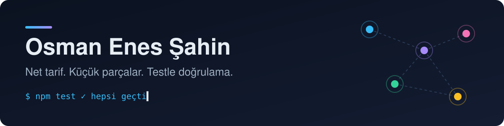
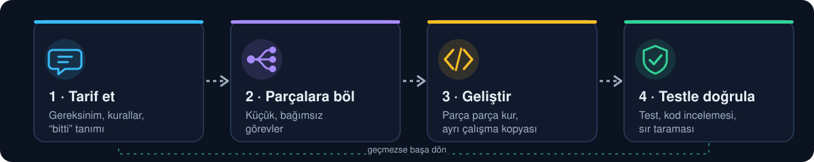
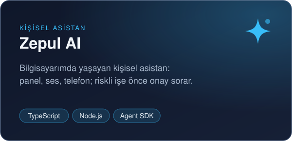
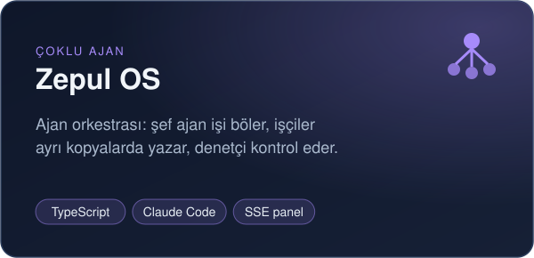
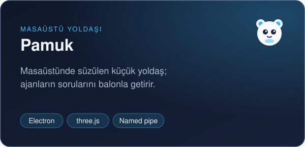
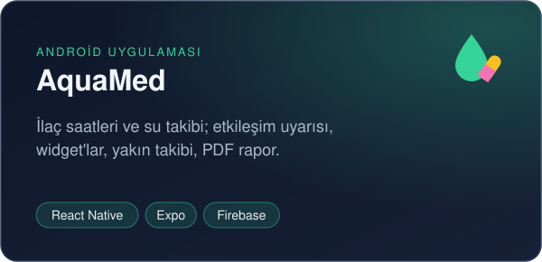
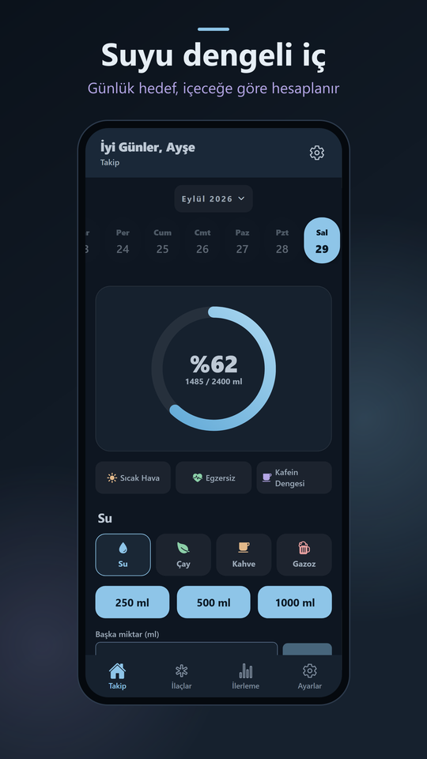
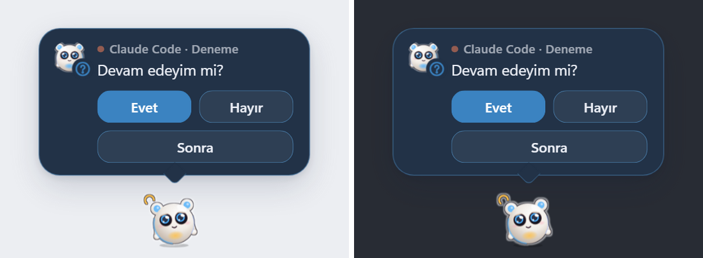
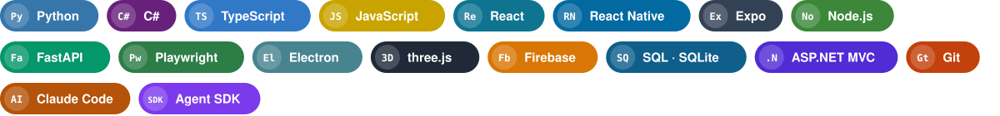

<picture>
  <source media="(prefers-color-scheme: dark)" srcset="assets/banner-koyu.svg">
  <source media="(prefers-color-scheme: light)" srcset="assets/banner-acik.svg">
  
</picture>

  Mobil uygulamalar, masaüstü araçları ve kendi ajan orkestram üzerinde çalışıyorum. 
  Yapay zekâ ajanlarıyla geliştiriyorum; benim işim <b>ne istediğimi net anlatmak</b>, işi parçalara bölmek ve çıkan sonucu <b>testle doğrulamak</b>.

## ⚙️ Nasıl çalışıyorum

<picture>
  <source media="(prefers-color-scheme: dark)" srcset="assets/akis-koyu.svg">
  <source media="(prefers-color-scheme: light)" srcset="assets/akis-acik.svg">
  
</picture>

- **Tarif et:** önce kuralları ve "bitti" tanımını yazarım; neyin doğru sonuç sayılacağı baştan bellidir.
- **Parçalara böl:** büyük işi küçük, bağımsız görevlere ayırırım; her parçanın sınırı ve sahibi bellidir.
- **Geliştir:** parçaları tek tek kurarım; gerektiğinde birkaç ajanla aynı anda, ayrı çalışma kopyalarında.
- **Testle doğrula:** test, kod incelemesi ve sır taraması geçmeden hiçbir şey birleşmez.

## 🧩 Projeler

<table>
  <tr>
    <td width="50%"></td>
    <td width="50%"></td>
  </tr>
  <tr>
    <td width="50%"></td>
    <td width="50%"></td>
  </tr>
</table>

## 📸 Ekrandan

<table>
  <tr>
    <td align="center" width="40%"> AquaMed · su takibi</td>
    <td align="center" width="60%"> Pamuk · bir ajanın sorusu masaüstünde</td>
  </tr>
</table>

## 🛠️ Kullandıklarım

<!--
shields.io ile alternatif satır (dış servise bağlıdır; kullanmak istersen yukarıdaki img yerine koy):

-->

🇬🇧 My job: say clearly what I want, split the work into small parts, and verify the result with tests.

